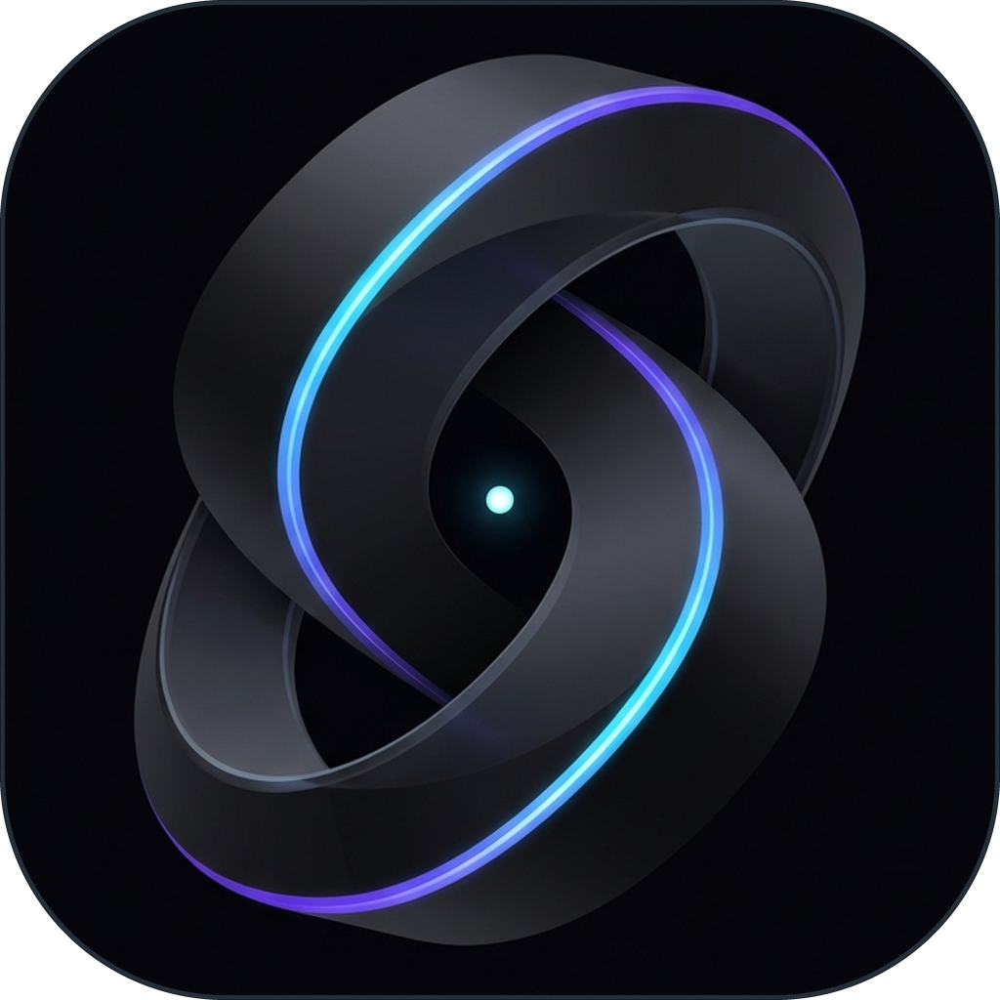

<p align="center">
  
</p>

<h1 align="center">Shadow • Luna</h1>
<p align="center">
  Offline-First Personal Device AI — Android App (<code>DeviceMemory</code>) &amp; Windows Desktop Studio (<code>LunaServer</code>)
</p>

---

## Highlights

- **100% Offline-First Mobile Engine**: On-device Tamil + English token indexing & blank-slate recall (`OnDeviceLunaBrain`) backed by encrypted SQLCipher Room storage — zero pre-built conversational knowledge or fake canned replies.
- **Minimalist Mobile UI (`Shadow.apk`, v0.3.0)**: Clean chat canvas with top-right `⋮` menu (`Updates`, `Learning Permission`, `Connect to Server`) and live countdown OTA lockout screen (`UpdateLockoutActivity`).
- **Explicit 2-Way Handshake Sync**: Phone stays offline until you tap **Connect to Server** on mobile and **Connect to App** on Windows Desktop (`WAITING_FOR_LAPTOP` → `TRANSFERRING` → permanent SQLite storage in `luna_memory.db`).
- **Windows Desktop Studio (`Shadow`)**: Consumer-focused Edge WebView2 desktop app (`luna_desktop.py` + `studio_ui.html`) that manages the FastAPI/Uvicorn backend silently in the background.
- **Privacy Guard (Option A)**: Web browser access to `/`, `/api/memories`, and `/api/graph` from non-localhost addresses returns `HTTP 403`.

---

## Project Structure

```text
├── DeviceMemory/          # Android multi-module Kotlin + Jetpack Compose project
│   ├── app/               # MainScreen, MainActivity, UpdateLockoutActivity, adaptive icons
│   ├── pipeline/          # OnDeviceLunaBrain, CollectionWorker, LunaSyncManager, OTA client
│   ├── core-database/     # Encrypted Room DB (SQLCipher) & DAOs
│   ├── core-common/       # Shared models, TamilSemanticChunker, TimestampUtil
│   └── collector-*/       # Modular on-device signal collectors
├── LunaServer/            # Windows Desktop App & FastAPI Local Core
│   ├── luna_desktop.py    # WebView2 ("Shadow") desktop app + background supervisor (:8765)
│   ├── studio_ui.html     # Modern dark desktop interface
│   ├── luna_server.py     # FastAPI memory, handshake, chat & OTA updates API (:8000)
│   ├── luna_ctl.py        # CLI bridge for desktop app & background server control
│   ├── generate_logo.py   # 2026 logo asset & adaptive icon generator
│   └── requirements.txt   # Python dependencies
├── shadow_luna_logo.png   # 1024x1024 master app icon
└── Shadow.apk             # Prebuilt Debug APK (v0.3.0)
```

---

## Quick Start

### 1. Mobile App (`Android`)
- Install prebuilt [`Shadow.apk`](Shadow.apk) directly on Android 8.0+ (`minSdk 26`), **or** build from source inside `DeviceMemory/`:
  ```powershell
  cd DeviceMemory
  .\gradlew.bat :app:assembleDebug :pipeline:testDebugUnitTest
  ```

### 2. Windows Desktop App (`LunaServer`)
```powershell
cd LunaServer
python -m venv .venv
.\.venv\Scripts\python.exe -m pip install -r requirements.txt
.\.venv\Scripts\python.exe luna_ctl.py open
```
